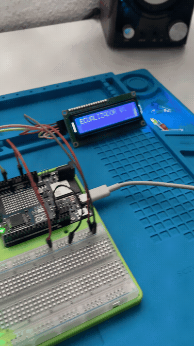
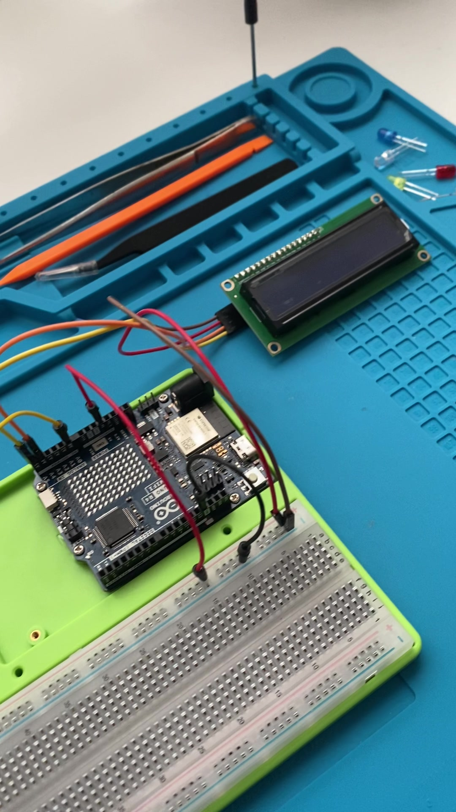

# Ecualizador de sonido

### VU-metro de sonido en pantalla LCD1602 con Arduino UNO R4 WiFi


Un sensor de sonido mide el volumen ambiente y una pantalla LCD1602 dibuja una **barra de nivel tipo ecualizador**, con resolución fina gracias a caracteres personalizados, más el porcentaje en tiempo real.

<p align="center">
  
</p>

## Índice

1. [Qué hace](#qué-hace)
2. [Hardware](#hardware)
3. [Esquema de conexión](#esquema-de-conexión)
4. [Cómo funciona el código](#cómo-funciona-el-código)
5. [Instalación y uso](#instalación-y-uso)
6. [Calibración](#calibración)
7. [Decisiones de diseño y problemas encontrados](#decisiones-de-diseño-y-problemas-encontrados)
8. [Posibles mejoras](#posibles-mejoras)
9. [Estructura del repositorio](#estructura-del-repositorio)

## Qué hace

- Lee el nivel de sonido ambiente con un sensor analógico (módulo basado en LM393).
- Dibuja una barra horizontal de 16 columnas en la fila de abajo del LCD, con hasta **80 pasos de resolución** (5 sub-niveles por columna) usando caracteres propios.
- Muestra el nivel en porcentaje en la esquina superior derecha.
- Sube rápido y baja despacio, como un VU-metro analógico real, en vez de ir dando saltos nerviosos.

## Hardware

| Cantidad | Componente | Notas |
|---|---|---|
| 1 | Arduino UNO R4 WiFi | Lógica de 5 V en todos sus pines digitales |
| 1 | Pantalla LCD1602 con módulo I2C | Dispositivo nativo de 5 V, sin riesgo de voltaje con el R4 |
| 1 | Sensor de sonido (módulo LM393) | Alimentado a 5 V, igual que el LCD |
| 1 | Protoboard | |
| — | Cables jumper macho-macho | |
| 1 | Cable USB-C de programación | |

## Esquema de conexión

| LCD1602 (módulo I2C) | Arduino | Sensor de sonido | Arduino |
|---|---|---|---|
| VCC | 5V | VCC | 5V |
| GND | GND | GND | GND |
| SDA | A4 | AO (salida analógica) | A0 |
| SCL | A5 | DO | sin conectar |

VCC y GND de ambos módulos se pueden compartir en los mismos carriles de la protoboard: una sola alimentación para los dos.

<p align="center">
  
</p>

## Cómo funciona el código

| Parte | Qué hace |
|---|---|
| `leerPicoSonido()` | En vez de una sola lectura de `analogRead()` (que salta demasiado), muestrea durante ~15 ms y se queda con la diferencia entre el valor máximo y el mínimo (pico a pico). Representa mejor el volumen real |
| Suavizado ataque/caída | Si el nuevo nivel es mayor que el actual, salta directo (respuesta rápida); si es menor, baja poco a poco (`actual*0.85 + nuevo*0.15`), igual que un VU-metro analógico |
| Caracteres personalizados | El LCD1602 solo tiene resolución de carácter completo por defecto. Se definen 4 caracteres con 1, 2, 3 y 4 de las 5 columnas de píxel rellenas (más el carácter 255, bloque sólido, que ya trae el LCD de serie), y así cada una de las 16 columnas de la barra puede estar en 5 estados distintos en vez de solo 2 |
| `dibujarBarra()` | Convierte el nivel (0.0–1.0) en una cantidad de "ticks" (0 a 80) y decide, columna a columna, si pinta el bloque vacío, parcial o lleno que le toca |

## Instalación y uso

1. Instala el [Arduino IDE](https://www.arduino.cc/en/software) y, desde el Gestor de placas, el paquete **Arduino UNO R4 Boards**.
2. Desde el Gestor de Librerías instala **LiquidCrystal_I2C**.
3. Abre `ecualizador_sonido.ino`, selecciona la placa *Arduino UNO R4 WiFi* y su puerto, y súbelo.
4. Al encender debería aparecer "ECUALIZADOR" arriba y la barra reaccionando al sonido ambiente abajo.

## Calibración

Los dos números del `constrain((picoBruto - 10) / 300.0, 0.0, 1.0)` dependen del sensor concreto y del ruido de fondo de la habitación, así que son un punto de partida, no un valor medido. Para ajustarlos: descomenta la línea `Serial.println(picoBruto);`, abre el Monitor Serie, mira qué valores salen en silencio y hablando/con música, y sustituye el `10` (suelo de ruido) y el `300` (rango hasta volumen alto) por lo que veas.

## Decisiones de diseño y problemas encontrados

| Problema | Causa | Solución |
|---|---|---|
| Los dos ESP32 disponibles no servían para este montaje | Son de 38 pines ("wide"), y ese ancho tapa por completo las dos hileras de huecos de una protoboard estándar — solo queda una fila de pines sueltos, sin sitio para cablear nada | Se pasó a Arduino UNO R4 WiFi, que al usar zócalos hembra se cablea siempre con jumpers, sin depender del ancho de la placa |
| Pantalla inicial (GC9A01 redonda) descartada | Es un display SPI a color de lógica **3,3 V exclusivamente**; el UNO R4 WiFi tiene lógica de **5 V en todos sus pines digitales**, da igual el pin de 3,3 V que use para alimentar algo — conectarla directa podía dañarla de forma permanente | Se cambió a una pantalla LCD1602, que es un dispositivo nativo de 5 V, compatible sin ningún adaptador ni divisor de tensión |
| Alimentar un módulo desde el pin de 3,3 V del Arduino no arregla el problema de lógica | Confundir alimentación (VCC) con nivel lógico de las señales: ambos son parámetros independientes. Bajar el VCC de un módulo no baja la tensión que el Arduino manda por SCK, MOSI, CS, etc., que sigue siendo de 5 V | Documentado aquí para no repetir el error: si en el futuro se usa un sensor o display de lógica 3,3 V con este Arduino, hace falta un conversor de nivel lógico de verdad, no basta con cambiar el pin de alimentación |

## Posibles mejoras

- Guardar y mostrar el pico histórico (nivel máximo alcanzado).
- Añadir un modo de color simulando un ecualizador real con un LED RGB o una tira de LEDs.
- Sacar la calibración (suelo de ruido y rango) a un modo de ajuste automático al arrancar, en vez de constantes fijas en el código.
- Mandar el nivel por WiFi (el UNO R4 WiFi lo soporta) a un panel web, aprovechando que ya no se usa esa conectividad en este sketch.

## Estructura del repositorio

```
ecualizador-sonido-arduino/
├── ecualizador_sonido.ino   Sketch de Arduino: lectura del sensor y dibujo de la barra en el LCD
├── LICENSE                  Licencia MIT
└── media/                   Demo y foto del montaje
```

## Autor

**Antonio Navarro** · Técnico en electrónica, estudiante del Grado Superior en Mantenimiento Electrónico · Málaga, España
[github.com/antonionzdev](https://github.com/antonionzdev)

## Licencia

Distribuido bajo licencia MIT. Consulta el archivo [LICENSE](LICENSE).
